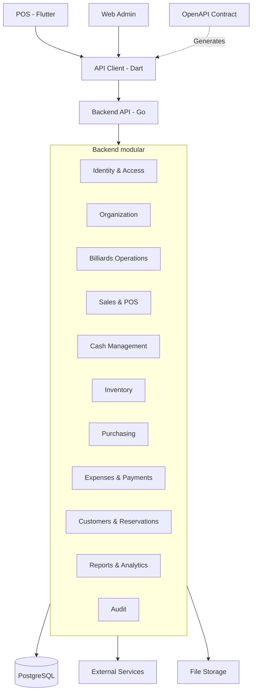

# Architecture — Billiards Management

## 1. Propósito

Este documento define la arquitectura general de **Billiards Management**, una plataforma integral para administrar las operaciones comerciales, financieras y operativas de uno o varios establecimientos de billar.

Describe la visión arquitectónica del producto, sus módulos, responsabilidades, comunicación, persistencia de datos, seguridad, infraestructura, integraciones y estrategia de evolución.

La arquitectura representa el sistema completo al que se quiere llegar. Su implementación será incremental: cada fase tendrá su propio alcance y planificación, documentados por separado.

## 2. Objetivos arquitectónicos

La arquitectura debe permitir:

- Administrar uno o varios establecimientos desde una plataforma centralizada.
- Gestionar mesas, sesiones de juego, ventas y pagos.
- Controlar inventario, compras, proveedores y gastos.
- Administrar clientes, reservas y empleados.
- Gestionar cajas, turnos y movimientos financieros.
- Generar reportes operativos y financieros.
- Mantener trazabilidad de las operaciones importantes.
- Integrar servicios externos cuando sea necesario.
- Incorporar nuevas funcionalidades sin comprometer los módulos existentes.
- Mantener independientes las interfaces de usuario y las reglas de negocio.
- Garantizar integridad, seguridad y consistencia de los datos.

## 3. Visión general de la arquitectura

Se utilizará inicialmente una arquitectura de **monolito modular**.

El backend estará desarrollado en Go y contendrá los módulos de negocio dentro de una misma aplicación. PostgreSQL será la base de datos principal.

Las aplicaciones cliente consumirán una API REST documentada mediante OpenAPI.

Esta arquitectura permite mantener una implementación sencilla al inicio, pero con límites modulares que faciliten la evolución del producto.

### 3.1. Componentes principales

| Componente | Tecnología | Responsabilidad |
|---|---|---|
| Backend API | Go | Reglas de negocio, casos de uso, seguridad y persistencia |
| POS | Flutter | Interfaz de operación diaria del establecimiento |
| Web Admin | Astro | Administración y configuración del sistema |
| API Client | Dart | Cliente tipado generado desde OpenAPI |
| API Contract | OpenAPI | Contrato entre backend y aplicaciones cliente |
| Base de datos | PostgreSQL | Persistencia e integridad de los datos |
| Infraestructura | Docker | Entornos de desarrollo y despliegue |

> Web Admin (Astro) forma parte de la visión futura; no está incluido en el MVP, que se opera únicamente desde el POS en Flutter.

### 3.2. Diagrama general



## 4. Actores del sistema

El sistema contempla los siguientes actores:

| Actor | Responsabilidad |
|---|---|
| Administrador | Administración general del negocio, reportes, configuración y gestión de establecimientos y usuarios. |
| Encargado | Supervisión de operaciones y personal de una sucursal; control de productos, existencias y movimientos. |
| Cajero | Ventas, cobros, administración de caja y gestión de mesas y sesiones. |

Los permisos de cada actor serán configurables mediante roles y permisos. Los servicios externos (pasarelas de pago, notificaciones) son integraciones, no actores del sistema.

## 5. Módulos funcionales

El sistema estará organizado en módulos de negocio independientes a nivel lógico.

Cada módulo será responsable de sus reglas, operaciones y datos. La separación inicial será interna al backend, sin requerir microservicios.

Este documento describe la **visión completa** del sistema. La implementación inicial cubre un subconjunto de módulos, detallado en `estructure.md` y en las decisiones de alcance de `docs/decisiones/`. Correspondencia:

| Feature del MVP | Módulo(s) de arquitectura |
|---|---|
| `users` | Identity & Access Management (y Employees más adelante) |
| `tables` | Billiards Operations + Pricing & Promotions |
| `sessions` | Billiards Operations + Pricing & Promotions |
| `products` | Point of Sale & Sales + Inventory |
| `consumptions` | Point of Sale & Sales + Inventory |
| `cash` | Cash Management + Payments |

### 5.1. Organization & Establishments

Administración de la organización y sus establecimientos.

Responsabilidades:

- Registro de organizaciones.
- Registro y administración de sucursales.
- Configuración general del negocio.
- Configuraciones específicas por establecimiento.
- Asignación de usuarios a establecimientos.
- Definición del ámbito de operación.
- Consulta consolidada de información.

### 5.2. Billiards Operations

Gestión de las operaciones relacionadas con las mesas de billar.

Responsabilidades:

- Registro y administración de mesas.
- Clasificación por tipos de mesa.
- Estados de disponibilidad.
- Inicio de sesiones de juego.
- Control del tiempo de juego.
- Pausar y reanudar sesiones.
- Finalización de sesiones.
- Cálculo de importes según tarifas.
- Asociación de consumos a sesiones.
- Historial de sesiones.
- Bloqueo de mesas por mantenimiento.

Una sesión de juego representa una operación concreta de uso de una mesa y debe conservar la información histórica de sus tarifas y condiciones.

### 5.3. Pricing & Promotions

Administración de tarifas y promociones.

Responsabilidades:

- Tarifas por mesa.
- Tarifas por tipo de mesa.
- Tarifas por horario.
- Tarifas por día de la semana.
- Calendarios de precios.
- Reglas de redondeo y cobro.
- Descuentos.
- Promociones.
- Vigencia de tarifas.
- Historial de cambios.

Las sesiones deben conservar la tarifa aplicada al momento de su creación o cálculo, evitando que modificaciones posteriores alteren importes históricos.

Regla vigente para el MVP: solo existen dos modalidades, **tiempo libre** y **tiempo fijo**. La tarifa es por hora y se cobra de forma proporcional a los minutos jugados. Ejemplo: una mesa a 15 Bs por hora, jugada 30 minutos, cobra 7.50 Bs. No se cobra por fracciones de 15 o 30 minutos ni se redondea a la unidad; el importe se guarda con dos decimales.

### 5.4. Point of Sale & Sales

Administración de ventas.

Responsabilidades:

- Catálogo de productos.
- Categorías y variantes.
- Carrito de venta.
- Registro de ventas.
- Detalle de productos vendidos.
- Descuentos e impuestos cuando correspondan.
- Asociación de ventas a clientes.
- Asociación de ventas a sesiones de juego.
- Asociación de ventas a establecimientos.
- Emisión de recibos.
- Anulaciones y devoluciones.
- Historial de ventas.

Los detalles de venta deben conservar snapshots de nombres, precios y otros datos relevantes al momento de la operación.

### 5.5. Payments

Gestión de pagos y transacciones.

Responsabilidades:

- Métodos de pago.
- Pagos en efectivo.
- Pagos en QR.
- Pagos parciales, si se habilitan.
- Pagos combinados.
- Estado de los pagos.
- Reembolsos.
- Reversos.
- Conciliación de pagos.

Los pagos deben estar relacionados con las operaciones que los originaron y mantener su trazabilidad.

### 5.6. Cash Management

Administración de cajas y turnos de caja.

Responsabilidades:

- Registro de cajas.
- Apertura de caja.
- Asignación de responsables.
- Fondo inicial.
- Ingresos y egresos.
- Retiros y depósitos.
- Movimientos relacionados con ventas y sesiones.
- Arqueos.
- Registro de efectivo contado.
- Cálculo del efectivo esperado.
- Identificación de diferencias.
- Cierre de caja.
- Historial de turnos.

Los movimientos financieros deben conservar su relación con las operaciones originales.

### 5.7. Inventory

Control de inventario.

Responsabilidades:

- Productos inventariables.
- Categorías de productos.
- Almacenes y ubicaciones.
- Existencias actuales.
- Entradas y salidas.
- Ajustes de inventario.
- Transferencias entre almacenes.
- Stock mínimo.
- Alertas de existencias.
- Kardex.
- Costos y valoración de inventario.

Los movimientos deben registrarse de manera trazable. No se debe modificar directamente el stock sin generar el movimiento correspondiente.

### 5.8. Purchasing

Administración de compras.

Responsabilidades:

- Solicitudes de compra.
- Órdenes de compra.
- Registro de proveedores.
- Detalles de compra.
- Recepción de productos.
- Costos de adquisición.
- Estados de las compras.
- Integración con inventario.
- Historial de compras.

La recepción de una compra puede generar movimientos de entrada de inventario.

### 5.9. Suppliers

Administración de proveedores.

Responsabilidades:

- Registro de proveedores.
- Información de contacto.
- Datos comerciales.
- Productos suministrados.
- Historial de compras.
- Condiciones comerciales.
- Estado del proveedor.

### 5.10. Expenses

Control de gastos.

Responsabilidades:

- Registro de gastos.
- Categorías de gastos.
- Fecha e importe.
- Responsable.
- Comprobantes.
- Estados de aprobación.
- Relación con caja.
- Medio de pago.
- Reportes de gastos.

### 5.11. Customers

Administración de clientes.

Responsabilidades:

- Registro de clientes.
- Datos de contacto.
- Historial de compras.
- Historial de sesiones.
- Preferencias no sensibles.
- Segmentación.
- Estado del cliente.
- Programa de fidelización.

El registro de clientes será opcional para operaciones que puedan realizarse sin identificar al comprador.

### 5.12. Reservations

Administración de reservas.

Responsabilidades:

- Registro de reservas.
- Consulta de disponibilidad.
- Asignación de mesas.
- Asociación con clientes.
- Confirmación.
- Cancelación.
- Registro de llegada.
- Anticipos o señas.
- Historial de reservas.

Una reserva y una sesión de juego son conceptos diferentes. Una reserva representa una intención de uso futuro; una sesión representa una operación de juego efectivamente iniciada.

### 5.13. Employees & Workforce

Administración de empleados y personal.

Responsabilidades:

- Registro de empleados.
- Datos laborales necesarios.
- Asignación a establecimientos.
- Estado del empleado.
- Asociación con cuentas de usuario.
- Turnos de trabajo.
- Historial de asignaciones.

Un empleado y una cuenta de usuario son entidades diferentes. No todos los empleados necesitan acceso al sistema.

### 5.14. Identity & Access Management

Administración de identidad y acceso.

Responsabilidades:

- Registro de usuarios.
- Autenticación.
- Gestión de credenciales.
- Roles.
- Permisos.
- Asignaciones de roles.
- Sesiones y tokens.
- Revocación de sesiones.
- Recuperación de acceso.
- Ámbito de acceso por establecimiento.

### 5.15. Maintenance

Gestión de mantenimiento de mesas, equipos y otros activos.

Responsabilidades:

- Registro de equipos y activos.
- Tipos de mantenimiento.
- Registro de incidencias.
- Órdenes de mantenimiento.
- Fechas y responsables.
- Historial de intervenciones.
- Costos de mantenimiento.
- Bloqueo de mesas o equipos.
- Habilitación después del mantenimiento.

### 5.16. Notifications

Administración de notificaciones.

Responsabilidades:

- Notificaciones internas.
- Plantillas.
- Eventos que generan notificaciones.
- Preferencias de usuarios.
- Canales de envío.
- Email y mensajería.
- Estado de entrega.
- Reintentos.

Este módulo informa sobre eventos; no debe ejecutar directamente las operaciones de negocio que originan las notificaciones.

### 5.17. Reports & Analytics

Generación de reportes e indicadores.

Responsabilidades:

- Reportes de ventas.
- Ingresos.
- Sesiones de juego.
- Utilización de mesas.
- Productos más vendidos.
- Inventario.
- Compras.
- Proveedores.
- Gastos.
- Caja.
- Clientes.
- Reservas.
- Comparativas por períodos.
- Indicadores de rendimiento.
- Exportación de información.

Los reportes deben respetar los permisos y el ámbito de acceso del usuario.

### 5.18. Audit & Activity Log

Registro de actividad y auditoría.

Responsabilidades:

- Identificar al usuario que realiza una operación.
- Registrar el establecimiento.
- Registrar la operación realizada.
- Identificar la entidad afectada.
- Registrar fecha y hora.
- Conservar cambios relevantes.
- Registrar motivos de anulaciones o ajustes.

Operaciones especialmente importantes:

- Ventas.
- Pagos.
- Reembolsos.
- Movimientos de caja.
- Ajustes de inventario.
- Compras.
- Modificaciones de tarifas.
- Reservas.
- Cambios de permisos.

Los registros de auditoría deben estar protegidos contra modificaciones no autorizadas y no deben almacenar contraseñas ni secretos.

### 5.19. System Configuration

Configuración general del sistema.

Responsabilidades:

- Moneda.
- Formatos de fecha y hora.
- Zona horaria.
- Parámetros operativos.
- Configuración de recibos.
- Configuración global.
- Configuración por establecimiento.
- Preferencias.
- Configuración de integraciones.

## 6. Responsabilidades de las aplicaciones

### 6.1. Backend API — Go

El backend es el núcleo del sistema y la fuente de verdad de las reglas de negocio.

Responsabilidades:

- Exponer la API REST.
- Autenticar usuarios.
- Autorizar operaciones.
- Validar solicitudes.
- Ejecutar casos de uso.
- Aplicar reglas de negocio.
- Coordinar módulos.
- Gestionar transacciones.
- Acceder a PostgreSQL.
- Integrar servicios externos.
- Generar errores consistentes.
- Registrar auditoría.
- Proporcionar datos para reportes.

Las reglas críticas no deben depender de la implementación del cliente.

### 6.2. POS — Flutter

Aplicación destinada a la operación diaria del establecimiento.

Responsabilidades:

- Visualizar mesas.
- Consultar disponibilidad.
- Iniciar y finalizar sesiones.
- Mostrar temporizadores.
- Registrar ventas.
- Gestionar carritos.
- Registrar pagos.
- Consultar productos.
- Consultar inventario según permisos.
- Gestionar caja.
- Consultar reservas.
- Mostrar información del cliente.
- Ejecutar operaciones autorizadas.

La aplicación debe consultar al backend para confirmar operaciones críticas.

### 6.3. Web Admin

Interfaz administrativa futura.

Responsabilidades:

- Configurar establecimientos.
- Administrar usuarios y permisos.
- Gestionar productos y tarifas.
- Administrar proveedores.
- Consultar reportes.
- Gestionar inventario.
- Administrar compras.
- Consultar caja.
- Gestionar reservas.
- Configurar el sistema.

Debe consumir la misma API que el POS y no duplicar reglas de negocio.

### 6.4. API Client — Dart

Cliente generado desde el contrato OpenAPI.

Responsabilidades:

- Consumir endpoints.
- Serializar y deserializar datos.
- Proporcionar modelos tipados.
- Centralizar la comunicación HTTP.

El código generado no debe modificarse manualmente. Los cambios deben realizarse en el contrato o en la configuración de generación.

### 6.5. PostgreSQL

Base de datos principal.

Responsabilidades:

- Persistencia relacional.
- Integridad referencial.
- Constraints.
- Transacciones.
- Índices.
- Consultas.
- Almacenamiento de información histórica.


## 7. Comunicación entre módulos

La comunicación interna será principalmente mediante llamadas entre servicios de aplicación e interfaces.

Se utilizarán dos modalidades:

### Comunicación síncrona

Para operaciones que necesitan una respuesta inmediata y consistencia.

Ejemplos:

- Registrar una venta.
- Registrar un pago.
- Finalizar una sesión.
- Actualizar inventario.
- Cerrar una caja.

### Comunicación asíncrona

Para tareas que no necesitan completarse dentro de la solicitud original.

Ejemplos:

- Enviar notificaciones.
- Generar reportes pesados.
- Procesar archivos.
- Exportar información.
- Integrar servicios externos.

Inicialmente no se requiere un broker externo. Se incorporará cuando el volumen o las necesidades de procesamiento lo justifiquen.

## 8. Diseño de la API

La comunicación entre aplicaciones y backend utilizará REST sobre HTTP con JSON.

### 8.1. Versionado

Los endpoints estarán versionados:

```text
/api/v1/
```

Los cambios compatibles podrán incorporarse sin romper los clientes existentes.

Los cambios incompatibles requerirán una estrategia de transición.

### 8.2. Ejemplos de endpoints

```http
GET    /api/v1/establishments

GET    /api/v1/tables
GET    /api/v1/tables/{id}

POST   /api/v1/sessions
POST   /api/v1/sessions/{id}/pause
POST   /api/v1/sessions/{id}/resume
POST   /api/v1/sessions/{id}/finish

GET    /api/v1/products
POST   /api/v1/sales

POST   /api/v1/purchases
GET    /api/v1/inventory/stock

POST   /api/v1/cash/shifts
POST   /api/v1/cash/shifts/{id}/close

GET    /api/v1/reports/sales
GET    /api/v1/reservations
```

Estos endpoints son ejemplos de organización. El contrato OpenAPI definirá las rutas definitivas.

### 8.3. Respuestas y errores

La API debe mantener una estructura consistente para:

- Respuestas exitosas.
- Errores de validación.
- Errores de autenticación.
- Errores de autorización.
- Recursos inexistentes.
- Conflictos de estado.
- Errores internos.

Los errores de negocio deben distinguirse de los errores técnicos.

## 9. OpenAPI como contrato

El archivo:

```text
contracts/openapi.yaml
```

será la fuente de verdad del contrato HTTP.

Flujo de trabajo:

1. Definir o actualizar el endpoint en OpenAPI.
2. Validar el contrato.
3. Generar el cliente Dart.
4. Implementar el endpoint en Go.
5. Integrar el cliente en Flutter.
6. Verificar la compatibilidad entre contrato y backend.

Reglas:

- Documentar endpoints y esquemas.
- Versionar los cambios.
- Mantener los ejemplos actualizados.
- No modificar manualmente el cliente generado.
- Evitar contratos que no coincidan con la implementación.

## 10. Persistencia y diseño de datos

PostgreSQL será la base de datos principal.

### 10.1. Principios

- Utilizar claves primarias y foráneas.
- Definir constraints.
- Mantener integridad referencial.
- Crear índices según los patrones de consulta.
- Utilizar transacciones para operaciones atómicas.
- Mantener historial cuando sea necesario.
- Versionar migraciones.
- Asociar las operaciones con su establecimiento.
- Definir claramente los estados de cada entidad.

### 10.2. Datos monetarios

No utilizar `FLOAT` o `DOUBLE PRECISION` para representar importes monetarios, ni en la base de datos ni en el dominio.

La convención del proyecto es usar **decimales de precisión fija**:

```sql
NUMERIC(12, 2)
```

En Go se representa con un tipo decimal (por ejemplo `shopspring/decimal` o `pgtype.Numeric`), nunca con `float64`. La moneda por defecto es `BOB`, configurable por sucursal. El cobro por tiempo se calcula por minuto y se redondea a dos decimales al generar la cuenta; no se redondea por tramo ni a la unidad.

### 10.3. Snapshots históricos

Las operaciones históricas deben conservar los datos relevantes al momento de realizarse.

Ejemplos:

- Precio del producto vendido.
- Nombre del producto vendido.
- Descuento aplicado.
- Tarifa aplicada a una sesión.
- Costo de adquisición de una compra.
- Establecimiento donde ocurrió la operación.
- Usuario responsable.

Una modificación posterior del catálogo o de las tarifas no debe alterar operaciones históricas.

### 10.4. Migraciones

Las modificaciones del esquema deben gestionarse mediante migraciones versionadas con **goose**, en archivos SQL con las secciones `-- +goose Up` y `-- +goose Down`.

Las migraciones deben:

- Ser revisables.
- Mantener un orden.
- Poder ejecutarse de manera controlada.
- Considerar compatibilidad con versiones desplegadas.
- Contar con respaldo previo cuando el cambio lo requiera.

## 11. Consistencia y concurrencia

Existen operaciones que requieren especial cuidado:

- Inicio y finalización de sesiones.
- Cobros.
- Ventas.
- Anulaciones.
- Reembolsos.
- Recepción de compras.
- Movimientos de inventario.
- Apertura y cierre de caja.
- Reservas.
- Transferencias entre establecimientos.

### 11.1. Transacciones

Las operaciones que modifican varias entidades relacionadas deben ejecutarse dentro de transacciones cuando corresponda.

Ejemplo: una venta puede involucrar:

1. Registro de venta.
2. Registro de detalles.
3. Registro de pagos.
4. Movimiento de inventario.
5. Movimiento de caja.
6. Registro de auditoría.

El diseño debe garantizar que no queden operaciones parcialmente registradas.

### 11.2. Concurrencia

Se deben contemplar escenarios como:

- Dos usuarios intentando ocupar la misma mesa.
- Dos ventas intentando consumir las mismas existencias.
- Dos usuarios modificando una misma caja.
- Dos reservas para el mismo horario.
- Transferencias simultáneas de inventario.

Se utilizarán constraints, bloqueos o niveles de aislamiento adecuados según cada operación.

### 11.3. Idempotencia

Las operaciones críticas deben considerar solicitudes repetidas por reintentos de red.

Especialmente:

- Ventas.
- Pagos.
- Reembolsos.
- Operaciones externas.

Se podrán utilizar claves de idempotencia para evitar duplicaciones.

## 12. Seguridad

### 12.1. Autenticación

El sistema debe contemplar:

- Inicio de sesión.
- Gestión segura de credenciales.
- Expiración de sesiones.
- Renovación de tokens cuando corresponda.
- Revocación.
- Recuperación de acceso.

El mecanismo definitivo se documentará mediante una decisión arquitectónica.

### 12.2. Autorización

La autorización se basará en:

- Identidad del usuario.
- Permisos asignados.
- Organización.
- Establecimiento.
- Recurso solicitado.
- Estado de la operación.
- Reglas de negocio.

Ejemplos de permisos:

```text
tables.operate
sales.create
sales.discount
cash.manage
cash.close
products.manage
inventory.manage
reports.financial.read
users.manage
establishments.manage
```

La autorización debe realizarse en el backend. Ocultar botones en Flutter no constituye una medida de seguridad.

### 12.3. Protección

- Utilizar HTTPS.
- No almacenar secretos en el repositorio.
- Aplicar mínimo privilegio.
- No exponer PostgreSQL directamente a Internet.
- Validar entradas.
- Proteger archivos privados.
- Evitar información sensible en logs.
- Mantener dependencias actualizadas.

## 13. Auditoría

Las operaciones relevantes deben registrar:

- Usuario responsable.
- Organización.
- Establecimiento.
- Tipo de operación.
- Entidad afectada.
- Identificador de la entidad.
- Fecha y hora.
- Cambios relevantes.
- Motivo, cuando corresponda.

La auditoría debe permitir reconstruir qué ocurrió sin depender exclusivamente de los logs técnicos.

## 14. Gestión de archivos

Los archivos binarios no se almacenarán directamente en PostgreSQL como estrategia general.

Se utilizará:

- PostgreSQL para metadatos y referencias.
- Sistema de archivos o almacenamiento de objetos para los archivos.

Se deben considerar:

- Validación del MIME type.
- Validación de tamaño.
- Control de permisos.
- Nombres seguros.
- Acceso privado.
- Retención.
- Copias de seguridad.

## 15. Integraciones externas

El sistema podrá integrarse con:

- Pasarelas de pago.
- Servicios de correo electrónico.
- Servicios de mensajería.
- Impresoras de recibos.
- Almacenamiento de objetos.
- Herramientas de monitoreo.
- Sistemas contables.

Las integraciones deben implementarse mediante adaptadores.

Se deben considerar:

- Timeouts.
- Reintentos.
- Idempotencia.
- Registro de errores.
- Conciliación de operaciones.
- Protección de credenciales.

## 16. Infraestructura y despliegue

### 16.1. Infraestructura inicial

Se podrá utilizar un VPS con Docker.

Componentes:

- Reverse proxy.
- Certificados HTTPS.
- Backend Go.
- PostgreSQL.
- Almacenamiento de archivos.
- Servicio de respaldos.
- Monitoreo.

### 16.2. Entornos

Se contemplan tres entornos:

| Entorno | Propósito |
|---|---|
| Development | Desarrollo local |
| Testing / Staging | Validación antes de producción |
| Production | Operación real |

Los entornos deben mantener configuraciones y credenciales independientes.

No se deben copiar datos de producción a desarrollo sin autorización y anonimización adecuada.

### 16.3. Docker

Docker se utilizará para:

- Estandarizar entornos.
- Ejecutar servicios.
- Facilitar pruebas.
- Simplificar despliegues.
- Mantener consistencia entre entornos.

Docker Compose puede utilizarse tanto para desarrollo como para un despliegue inicial sencillo.

La persistencia de PostgreSQL, redes, secretos y actualizaciones debe configurarse cuidadosamente.

## 17. Backups y recuperación

Se deben implementar copias de seguridad periódicas de:

- PostgreSQL.
- Archivos almacenados.
- Configuraciones necesarias para recuperar el sistema.

Las copias deben:

- Mantenerse fuera del servidor principal.
- Tener políticas de retención.
- Estar protegidas.
- Verificarse periódicamente.
- Contar con procedimientos documentados de restauración.

Se deben definir objetivos de recuperación:

- RPO: cantidad máxima de datos que se acepta perder.
- RTO: tiempo objetivo para recuperar el servicio.

Un backup no debe considerarse confiable hasta que se haya probado su restauración.

## 18. Observabilidad

El sistema debe contar con:

### Logs

- Logs estructurados.
- Niveles de severidad.
- Identificadores de correlación.
- Contexto suficiente para diagnosticar errores.

### Métricas

- Disponibilidad de la API.
- Latencia.
- Tasa de errores.
- Uso de recursos.
- Estado de PostgreSQL.
- Cantidad de operaciones.

### Alertas

- Caídas del servicio.
- Errores recurrentes.
- Problemas de conexión.
- Fallos de respaldos.
- Uso excesivo de recursos.

Los logs técnicos y los registros de auditoría deben mantenerse como conceptos separados.

## 19. Requisitos no funcionales

La arquitectura debe considerar:

| Atributo | Objetivo |
|---|---|
| Fiabilidad | Operaciones consistentes y predecibles |
| Integridad | Evitar datos inconsistentes |
| Seguridad | Proteger información y operaciones |
| Mantenibilidad | Facilitar cambios y correcciones |
| Modularidad | Separar responsabilidades |
| Rendimiento | Responder eficientemente |
| Recuperabilidad | Permitir restaurar el servicio |
| Usabilidad | Facilitar la operación diaria |
| Escalabilidad | Soportar crecimiento del negocio |
| Trazabilidad | Reconstruir operaciones importantes |
| Compatibilidad | Mantener clientes y API coordinados |

Los objetivos cuantitativos de disponibilidad y rendimiento se definirán cuando existan requisitos operativos medibles.

## 20. Estrategia de escalabilidad

La arquitectura inicial será un monolito modular.

La evolución prevista será:

1. Mantener límites claros entre módulos.
2. Optimizar consultas e índices.
3. Aplicar connection pooling.
4. Incorporar procesamiento asíncrono cuando sea necesario.
5. Incorporar caché cuando exista una necesidad comprobada.
6. Permitir múltiples instancias del backend.
7. Evaluar la separación de servicios solo cuando exista una razón técnica u operativa.

No se introducirán microservicios desde el inicio sin una necesidad concreta.

## 21. Soporte multi-sucursal

El sistema debe estar preparado para administrar varios establecimientos.

Principios:

- Cada operación debe estar asociada al establecimiento correspondiente.
- Los usuarios podrán acceder a uno o varios establecimientos según sus permisos.
- Los reportes podrán consultarse por establecimiento o de forma consolidada.
- Las configuraciones podrán ser globales o específicas.
- Caja, inventario y mesas tendrán un ámbito definido.
- Las transferencias entre establecimientos serán operaciones explícitas.

Inicialmente se utilizará aislamiento lógico dentro de una misma base de datos.

La separación física de bases de datos se evaluará solamente si las necesidades lo justifican.

## 22. Estructura del monorepo

La estructura propuesta es:

```text
billiards-management/
├── apps/
│   ├── api/
│   │   ├── cmd/
│   │   ├── internal/
│   │   ├── db/
│   │   │   ├── migrations/
│   │   │   ├── queries/
│   │   │   └── seeds/
│   │   ├── Dockerfile
│   │   ├── go.mod
│   │   └── sqlc.yaml
│   │
│   └── pos/
│
├── packages/
│   └── api_client/
│
├── contracts/
│   └── openapi.yaml
│
├── infra/
│   ├── docker/
│   │   └── compose.yml
│   ├── deploy/
│   └── backups/
│
├── docs/
│   ├── architecture.md
│   ├── estructure.md
│   ├── billiards_modelo.dbml
│   └── decisiones/
│
├── scripts/
├── .github/
│   └── workflows/
│
├── Makefile
├── .gitignore
└── README.md
```

El árbol detallado de `apps/api` y `apps/pos` se mantiene en `estructure.md` para evitar duplicación.

La estructura podrá evolucionar conforme aumente el tamaño del proyecto.

## 23. Architecture Decision Records (ADR)

Las decisiones arquitectónicas importantes se documentarán mediante ADR.

Ubicación:

```text
docs/decisiones/
```

Decisiones iniciales propuestas:

| ADR | Decisión |
|---|---|
| ADR-001 | Arquitectura de monolito modular |
| ADR-002 | Go para el backend |
| ADR-003 | Flutter para el POS |
| ADR-004 | PostgreSQL como base de datos |
| ADR-005 | OpenAPI como contrato |
| ADR-006 | Generación del cliente Dart |
| ADR-007 | Docker para entornos |
| ADR-008 | VPS para el despliegue inicial |
| ADR-009 | Migraciones versionadas |

Cada ADR debe incluir:

- Contexto.
- Problema.
- Decisión.
- Alternativas consideradas.
- Motivos.
- Consecuencias.

Los ADR históricos no deben eliminarse. Cuando una decisión cambie, se debe documentar la nueva decisión y marcar la anterior como reemplazada.

## 24. Evolución del producto

La implementación se realizará por fases.

La arquitectura contempla desde el inicio los módulos del producto completo, pero no exige desarrollarlos todos simultáneamente.

La evolución funcional podrá incluir:

1. Operaciones de mesas y sesiones.
2. Ventas y pagos.
3. Caja y turnos.
4. Productos e inventario.
5. Compras y proveedores.
6. Clientes y fidelización.
7. Reservas.
8. Gastos y administración financiera.
9. Mantenimiento.
10. Multi-sucursal.
11. Web Admin.
12. Reportes y analítica.
13. Integraciones externas.
14. Notificaciones y automatizaciones.

Cada fase debe definir sus funcionalidades, modelo de datos, endpoints, validaciones y pruebas.

## 25. Principios arquitectónicos

Los siguientes principios orientarán las decisiones técnicas:

- **Simplicity First:** preferir soluciones simples mientras sean suficientes.
- **Modularity:** mantener responsabilidades y límites claros.
- **Single Source of Truth:** mantener una fuente de verdad para los datos y reglas.
- **Backend-driven Business Logic:** centralizar las reglas críticas en el backend.
- **Contract-driven API:** mantener OpenAPI como contrato.
- **Data Integrity:** priorizar la integridad de la información.
- **Traceability:** registrar las operaciones importantes.
- **Incremental Development:** desarrollar por fases.
- **Evolutionary Architecture:** permitir que la arquitectura evolucione.
- **Maintainability:** priorizar código comprensible y mantenible.
- **Reliability:** garantizar operaciones consistentes.
- **Security by Design:** considerar la seguridad desde el diseño.
- **Least Privilege:** otorgar solamente los permisos necesarios.
- **Explicit Boundaries:** evitar dependencias ocultas entre módulos.

## 26. Resumen

Billiards Management se diseñará como una plataforma integral para administrar establecimientos de billar.

La arquitectura inicial utilizará:

- Go para el backend.
- Flutter para el POS.
- PostgreSQL para persistencia.
- OpenAPI como contrato de comunicación.
- Dart para el cliente API generado.
- Docker para entornos y despliegues.

El backend seguirá una arquitectura de monolito modular, con separación de responsabilidades y límites explícitos entre módulos.

La visión contempla operaciones de billar, ventas, pagos, caja, inventario, compras, proveedores, clientes, reservas, empleados, mantenimiento, reportes, auditoría e integraciones.

El sistema se implementará de forma incremental, manteniendo una arquitectura preparada para evolucionar sin introducir complejidad innecesaria desde el inicio.

